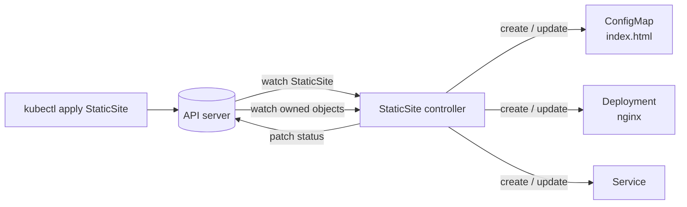

# staticsite-operator

[](https://github.com/giordanGarci/staticsite-operator/actions/workflows/ci.yaml)

A small Kubernetes operator written in Go with [controller-runtime](https://github.com/kubernetes-sigs/controller-runtime). It adds a `StaticSite` custom resource: you declare some HTML and a replica count, and the controller creates and maintains the nginx Deployment, ConfigMap and Service needed to serve it.

I built it as a hands-on study project for Custom Resource Definitions, custom controllers and the operator pattern.

```yaml
apiVersion: sites.giordan.io/v1alpha1
kind: StaticSite
metadata:
  name: hello
spec:
  replicas: 2
  content: |
    <h1>Hello from a Kubernetes operator!</h1>
```

```console
$ kubectl get staticsites
NAME    REPLICAS   READY   URL                                        AGE
hello   2          2       http://hello.default.svc.cluster.local     40s
```

## How it works



Each call to `Reconcile` reads the `StaticSite`, computes the desired state of its three child objects and applies it with `CreateOrUpdate`. The loop is level-based and idempotent: it does not care which event triggered it, so it is safe to run any number of times.

| Concept | Where it shows up |
| --- | --- |
| **CRD with an OpenAPI schema** | `api/v1alpha1/staticsite_types.go`. Kubebuilder markers generate validation (`minLength`, `minimum`/`maximum`), defaults (`replicas: 1`, `image: nginx:1.27-alpine`), printer columns and the short name `site`. |
| **Status subresource and conditions** | The controller writes `observedGeneration`, `readyReplicas`, `url` and a standard `Ready` condition, so `kubectl wait --for=condition=Ready staticsite/hello` works. |
| **Scale subresource** | `kubectl scale staticsite/hello --replicas=3` works like it does for a Deployment. |
| **Owner references and garbage collection** | Every child gets a controller `ownerReference`. Deleting the `StaticSite` lets the Kubernetes garbage collector remove the children, so no finalizer is needed. |
| **Watching owned resources** | `Owns(&appsv1.Deployment{})` (and ConfigMap, Service) re-triggers the parent reconcile when a child changes, which keeps `status` in sync and repairs manual edits or deletions. |
| **Rolling update on config change** | A hash of the HTML is stored in a pod template annotation, so changing `spec.content` rolls the pods instead of waiting for the kubelet to refresh the mounted ConfigMap. |
| **Least-privilege RBAC** | `+kubebuilder:rbac` markers generate `config/rbac/role.yaml`. |
| **Leader election, health probes** | Standard controller-runtime manager setup in `cmd/main.go`. |

## Project layout

```
api/v1alpha1/            CRD Go types and kubebuilder markers
internal/controller/     reconcile loop and desired-state builders, plus unit tests
cmd/main.go              manager entrypoint
config/crd/              generated CRD manifest
config/rbac/             generated ClusterRole plus ServiceAccount and bindings
config/manager/          controller Deployment
config/default/          kustomize overlay that installs everything
config/samples/          example StaticSite
hack/e2e.sh              end-to-end test against a real cluster
```

## Running it

Requirements: Go 1.22+, Docker, [kind](https://kind.sigs.k8s.io/), kubectl.

```sh
make kind-create      # local cluster
make kind-load        # build the image and load it into kind
make deploy           # CRD + RBAC + controller (kubectl apply -k config/default)

kubectl apply -f config/samples/sites_v1alpha1_staticsite.yaml
kubectl get staticsites -w
kubectl port-forward svc/hello 8080:80   # then open http://localhost:8080
```

To iterate quickly, run the controller on your machine against the current kube context instead of in the cluster:

```sh
make run
```

Clean up with `make undeploy` and `kind delete cluster --name staticsite`.

## Tests

- **Unit tests** (`make test`) run the reconciler against controller-runtime's fake client. They check that the child objects are created with owner references, that a content change updates the hash annotation, and that `status` follows the Deployment.
- **End-to-end** (`make e2e`, run in CI on a kind cluster) creates a `StaticSite`, curls it from inside the cluster, updates the content, scales it through the scale subresource and verifies garbage collection on delete.

CI also regenerates the CRD, RBAC and DeepCopy code and fails if they drift from what is committed.

## Possible next steps

- Admission webhook for validation that a schema cannot express
- envtest-based integration tests against a real API server
- Server-side apply instead of `CreateOrUpdate`
- A `v1beta1` version with a conversion webhook

## License

MIT
